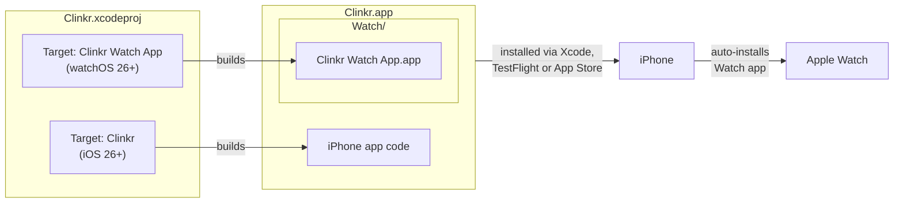
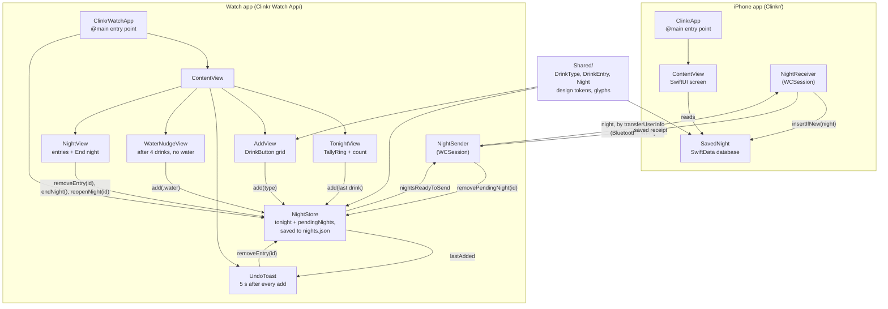
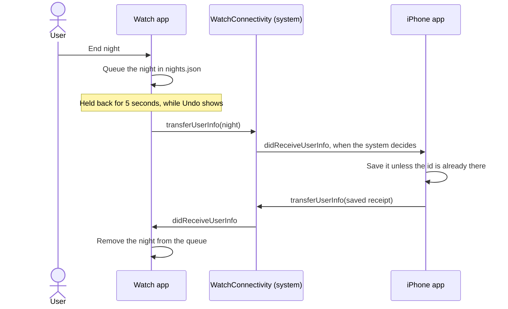

# Clinkr architecture

How the iPhone app and the Apple Watch app fit together. Solid lines are what exists today. Dashed boxes and lines are the usual next pieces, which aren't built yet.

## 1. From project to devices

One Xcode project builds two apps. The Watch app is packed inside the iPhone app, and the Watch installs it automatically when the iPhone app is installed.

## 2. Inside each app

Both apps are SwiftUI apps with the same shape. Each one starts at an `@main` App struct, which shows a `ContentView`. Both compile `Shared/`: the data model (`DrinkType`, `DrinkEntry`, `Night`) and the design system (colors, text styles, spacing, radii and drink glyphs). The Watch's screens are vertical pages: Tonight, with the `TallyRing`, then Add, then Night, which lists tonight's entries (a swipe removes one) and ends the night. The Watch keeps tonight in `NightStore`, which the Add screen's drink buttons and a tap on the ring write to. The store remembers the last entry added, and `ContentView` shows an `UndoToast` for it under the screen for 5 seconds; Undo removes that entry. After 4 drinks in a row with no water, `ContentView` also slides up a `WaterNudgeView` once that drink's toast has had its 5 seconds, at most once an hour and never within 30 minutes of a "Later". A night ends with End night, or when the next drink comes after a 12-hour gap (End night that late also counts from the last entry), and then moves to `pendingNights`, a queue waiting for the iPhone sync. For 5 seconds after End night, Undo takes the night back out of the queue with `reopenNight(id:)`, as long as it's still the last night there and no new one has started. Once Undo is over, `NightSender` sends the night to the iPhone. On the iPhone, `NightReceiver` starts at launch and saves each night it receives as a `SavedNight` in SwiftData, Apple's on-device database, skipping any id it already has. It then sends a receipt back, and only that removes the night from the Watch's queue. Until then, the Watch sends the night again whenever the app comes and goes, and a background refresh about every 15 minutes does the same. If the database won't open, the iPhone shows a message instead of the list and receives nothing, so the Watch keeps its nights. `ContentView` is a plain list of those nights until the History screen (#12) replaces it.

## 3. How a night travels from the Watch to the iPhone

Apple's WatchConnectivity framework queues the night and delivers it when it can, even if the iPhone app isn't running. The system wakes the iPhone app in the background to receive it. The Watch keeps the night until the iPhone's receipt arrives and sends it again if it can, so a night can arrive more than once. The iPhone matches by id and sends a receipt each time.

